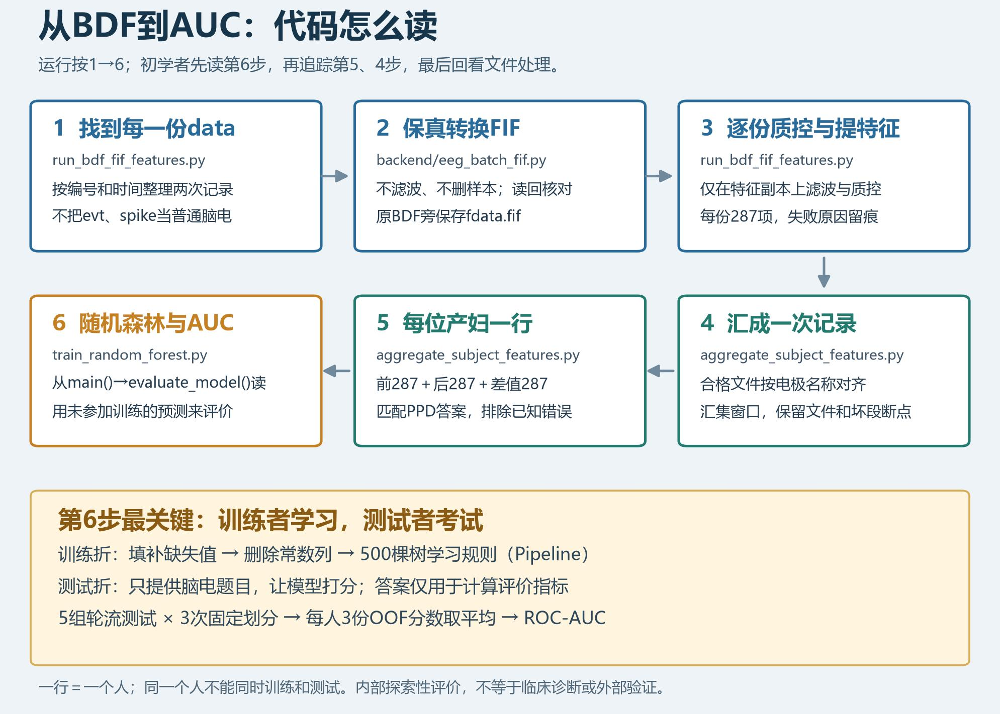

# 从BDF到AUC：按这条路线读代码

这套批处理用于探索“现有脑电是否具有区分后续PPD标签的信号”。它不会给出临床诊断。
原始BDF保留不动；未经滤波的FIF用于后续复核，经过预处理的副本用于特征计算。



图片由`tools/build_batch_code_flow.py`生成，可以直接保存JPG。

## 先认识三张表

1. **逐文件表**：一份`data.bdf`对应一张287项特征表。一个人可能有很多份文件。
2. **逐记录表**：把一次记录内的合格窗口汇集，重新计算287项特征。缺口前后独立计算。
3. **逐产妇表**：每个人一行，镇痛前287项、镇痛后287项、后减前287项，共861项。

不能把一个人的文件随机分散到训练集和测试集，否则模型可能只是“认人”。

## 建议的阅读顺序

先看`tools/train_random_forest.py`的`main()`。把它当成一道主程序：读表、检查、规定模型、评价、画图。
接着看`evaluate_model()`：一部分人用于学习，另一部分人用于考试，反复轮换；每个人只能在没有参加训练时得到考试成绩。
再看`make_model()`：它把填补缺失值、删除常数列、随机森林装进同一个流水线，防止测试集影响训练。
最后看`prediction_metrics()`和`auc_interval()`，了解AUC、ACC和区间的计算。

初次看到下面这些词，可以先这样理解：

|代码中的词|直白含义|
|---|---|
|`DataFrame`|一张有行名、列名的表|
|`X`|题目：一行是一位产妇，一列是一项脑电特征|
|`y`|标准答案：这位产妇的PPD标签，0或1|
|`train_indices` / `test_indices`|训练和考试的表格行号，不能互相重叠|
|`fit()`|只用训练者学习规则|
|`predict_proba()`|给测试者打分；这里取PPD=1那一列，不等于已验证临床风险|
|`Pipeline`|顺序执行的流水线：填空、删常数、建树|
|`StratifiedKFold`|把人分成5组，每组阳性比例尽量相近，轮流考试|
|`random_state`|固定随机过程的起点，让结果能重现，不是患者特征|
|`OOF`|这个人没有参加该次训练时得到的测试分数|

例如，`model.fit(X.iloc[train_indices], y[train_indices])`表示“只拿训练行的题目和答案来学习”；
紧接着的`model.predict_proba(X.iloc[test_indices])`表示“只给测试行的题目，让模型答题”。
测试答案只在最后计算AUC等指标时使用。先把这两行的区别弄懂，就抓住了模型评价的关键。

然后往前追输入表怎么来的：

|顺序|文件|要弄懂的事情|
|---|---|---|
|1|`tools/train_random_forest.py`|模型怎么学习、怎么考试、AUC怎么计算|
|2|`tools/aggregate_subject_features.py`|文件怎样变成记录、记录怎样变成独立产妇|
|3|`tools/run_bdf_fif_features.py`|怎样遍历文件、转换后读取FIF、质控并提取特征|
|4|`backend/eeg_batch_fif.py`|怎样保留原始样本、坐标、注释，并读回核对|
|5|`backend/eeg_preprocessing.py`|哪些通道和2秒片段被排除，为什么|
|6|`backend/eeg_thesis_features.py`|时域、频域、时频、网络的精确定义|

`scripts/run_batch_fif_rf.ps1`只是把上面几步依次叫起来；不需要先把它完全看懂。

## BDF转FIF和“清洗”是两件事

转换时不滤波、不重采样、不重新参考、不删坏道或坏段，不把自动候选当成已确认标记。
不同采样率的原始信号分组保存，主文件为原BDF目录的`fdata.fif`；如果还有其他原采样率组，会有`fdata_group2.fif`等文件。
标准10–20坐标来自模板，不代表实测位置。原始文件中的注释保留；独立evt文件没有未经确认就赋予临床事件含义。
程序将所有样本读回核对，再由复制器核对SHA-256。仅有文件头而没有采样数据的BDF无法生成有意义的FIF，会明确记为失败。

特征副本沿用网站`thesis_v1`方案：250 Hz、0.5–45 Hz零相位Butterworth带通、50/100 Hz可用陷波、2秒质控窗口、原采集参考。
N=4是Butterworth低通原型阶数；带通单程8阶，双向有效16阶，最终幅频响应为单程响应的平方。
按文件头电压单位换算，不附加未经证实的÷1000修正。
保留通道至少3个，绝对幅值阈值150 µV、通道标准差0.8–300 µV、方差Z阈值4、至少10%窗口合格等规则可在`protocol.json`核对。

本方案每时相287列：时域84、频域103、时频70、网络30。缺失电极对应的特征留空，不虚构电极。
网络计算沿用网站设置，以60,000点为目标上限计算均匀抽样步长；较短记录使用全部相位采样点。具体步长和实际点数在每次记录的`coverage.json`中保存。
在一次记录内只用合格文件共同保留的通道；镇痛前后各用全部可用数据，没有强行把两次记录裁成等长。
因此仍要关注有效时长、通道覆盖和伪迹残留的影响。
两个时相的保留电极也可能不同，因此差值是当前可用电极汇总值相减，不能直接解释为固定电极集合上的生理改变。后续需要共同电极和匹配有效时长的敏感性分析。

## 随机森林用了哪些固定规则

仅脑电预测，不把编号、姓名、文件路径、PPD time或其他随访资料作为特征。
基线表的PPD是结局；PPD=1且PPD time=0按已确认的记录错误删除；同编号身份冲突不自动合并。
更早和更晚的两次文件夹时间对应镇痛前后，这一临床含义已由用户确认。

主要模型用镇痛前、镇痛后和差值861项；对照模型只用镇痛前287项。两者用相同的配对人群和分折。
每个模型500棵树，叶子至少5人，使用类别平衡权重，没有根据AUC搜索最优参数。
中位数填补和常数列删除在每个训练折内进行；随机森林不要求标准化。
方差和Hjorth活动性等重复定义仍保留在特征目录中，不能当成独立的生理证据。

3个预先固定种子分别做分层5折交叉验证。每个人每次都有一份没有参加训练的预测，称为OOF（out-of-fold）。
把同一个人的3次OOF概率平均，再计算AUC。报告也保留每次划分的AUC，便于观察偶然性。
这是固定模型的内部验证，没有调参，因此不需要把它冒称为“最优模型”或外部验证。

## 怎样看AUC和ACC

AUC可以理解为：随机抽一位PPD=1和一位PPD=0的人，模型给前者更高分的能力。0.5接近随机排序，1表示完全区分。
AUC从概率计算，不是从0/1预测计算，也不代表“有多少人的诊断正确”。
ACC需要先选阈值；这里事先固定为0.5，同时报告敏感度和特异度。
如果大多数人PPD=0，全部预测为0也能有较高ACC，所以要看多数类别基线。
区间来自按人抽样2000次，条件于已经生成的OOF预测；没有反复重训，不代表全部建模不确定性。

如果结果接近0.5，说明这一批数据、当前质控和特征方案尚未表现出可靠的区分能力。
即使高于0.5，也要检查区间、身份和结局定义、伪迹、参考、幅度标定、通道覆盖以及独立样本验证，才能讨论推广。
文件夹含姓名不等于临床身份已经核验；现有PPD量表/诊断标准与采集资料仍不完整。

## 结果在哪里

原BDF旁：`fdata.fif`、必要的其他采样率组、`fdata_batch_manifest.json`。
本机结果目录：

|文件|用途|
|---|---|
|`随机森林探索性报告.html`|双击阅读总结果|
|`files/*/features_287.csv`|每份data的特征|
|`files/*/result.json`|每份文件是否成功、质控原因、原始文件指纹|
|`sessions/*/features_287.csv`|每次记录汇集后的特征|
|`subject_features_private.csv`|每人一行的最终建模表|
|`subject_record_coverage_private.csv`|纳入者镇痛前后的有效时长与通道数，供复核，不是模型输入|
|`subject_feature_missingness.csv`|逐特征的缺失比例|
|`subject_exclusions_private.csv`|被排除的编号与原因|
|`*_oof_predictions_private.csv`|每个人的内部测试预测，用于复核AUC|
|`*_fold_assignments_private.csv`|每个人属于哪次划分的哪一折|
|`random_forest_protocol.json`|固定参数和软件版本|
|`random_forest_results.json`|两种模型的评价数值|
|`validation_summary.json`|标签对应、受试者分折、AUC/ACC独立重算和报告链接的复核结果|
|`*_final_research_model.joblib`|评价结束后用全体样本训练的研究模型，不能再次拿训练者证明效果|

所有含受试者数据的结果只保存在本机忽略目录，不随代码上传GitHub。

## 重新运行

在项目目录的PowerShell里运行下面的形式，把占位路径替换为本机实际路径：

```powershell
.\scripts\run_batch_fif_rf.ps1 -InputRoot '脑电文件夹完整路径' -Baseline '基线资料.xlsx完整路径' -OutputDirectory '结果文件夹完整路径'
```

默认使用`.venv-mne-review`环境。其他环境通过`-PythonExecutable 'python.exe完整路径'`指定。
最后的`tools/validate_batch_results.py`只复核既有输出，不重训或调参。
转换与提取可以断点续跑：源文件未变且已成功的文件会跳过；已存在但不属于本批次的FIF不会被覆盖。
如果修改了质控或特征实现，应使用新的结果目录，不能把旧缓存和新定义混在一起。

参考：[scikit-learn防止数据泄漏](https://scikit-learn.org/stable/common_pitfalls.html)、[随机森林接口](https://scikit-learn.org/stable/modules/generated/sklearn.ensemble.RandomForestClassifier.html)、[AUC定义](https://scikit-learn.org/stable/modules/generated/sklearn.metrics.roc_auc_score.html)。
